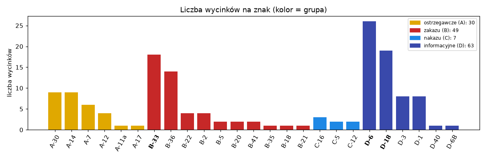
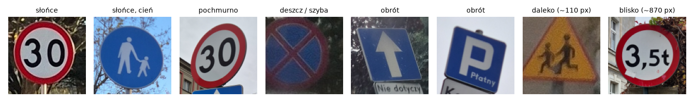
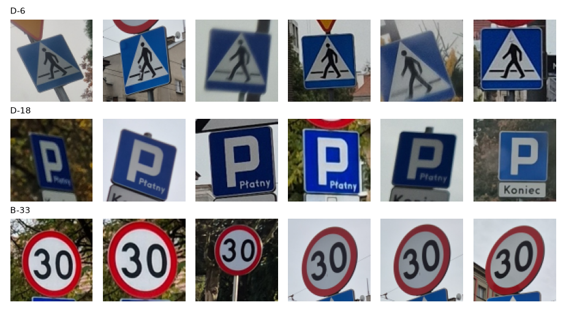
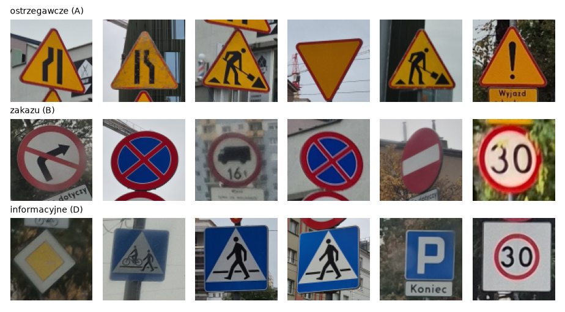
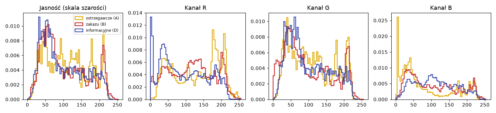
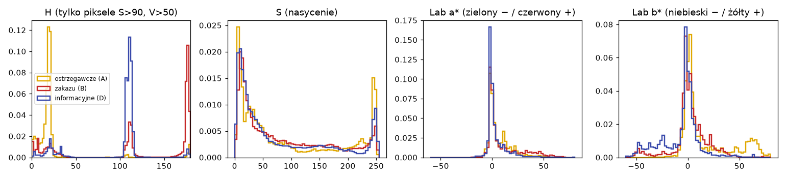
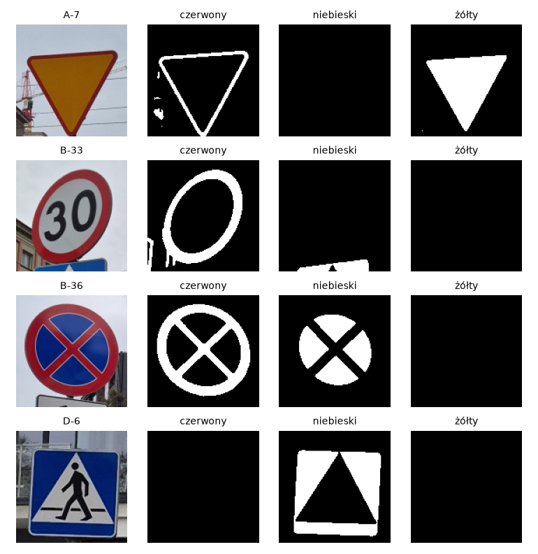
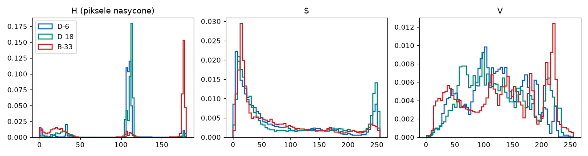
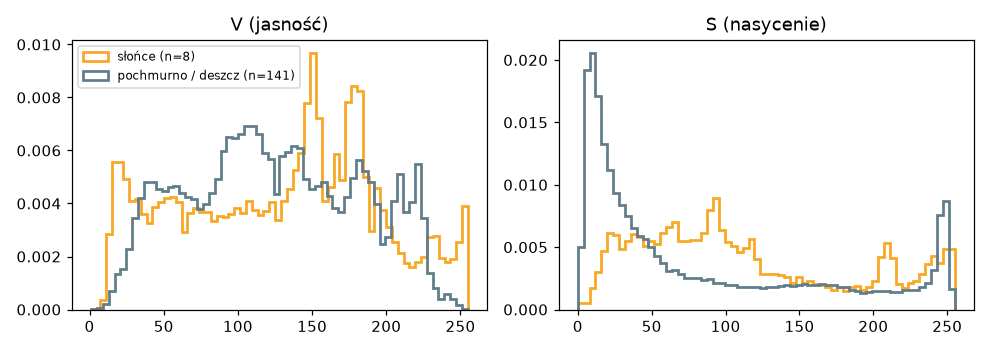
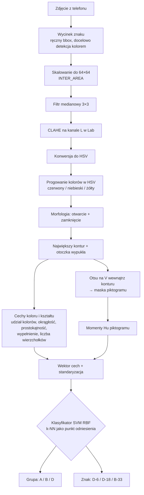

# Rozpoznawanie znaków drogowych — Technika Obrazowa

Autor: Wiktor Kęska

Raport koncepcyjny (etap 1): zbiór zdjęć, wstępna analiza kolorów i jasności oraz projekt potoku przetwarzania od zdjęcia do wyniku klasyfikacji. Na tym etapie nie ma jeszcze kodu klasyfikatora.

## Cel projektu

Dwa zadania klasyfikacji na własnych zdjęciach:

| Zadanie | Klasy | Liczba wycinków |
|---|---|---|
| **3 konkretne znaki** | **D-6** przejście dla pieszych, **D-18** parking, **B-33** ograniczenie prędkości | 26 / 19 / 18 |
| **3 grupy znaków** | **A** ostrzegawcze, **B** zakazu, **D** informacyjne | 30 / 49 / 63 |

Znaki i grupy wybrałem tak, żeby każda klasa miała jak najwięcej przykładów. Grupa **C** (nakazu) ma tylko 7 wycinków. Zostaje w zbiorze, ale jest za mała na osobną klasę. Ciekawą parą są D-6 i D-18: oba to niebieskie kwadraty, więc kolor ich nie rozróżni i trzeba sięgnąć po kształt piktogramu.

---

## 1. Zdjęcia

- **105 zdjęć** zrobionych telefonem (3060×4080) w Poznaniu, październik 2026.
- Z 97 zdjęć wyciąłem ręcznie **149 pojedynczych znaków**. Zdjęcia z kilkoma znakami rozdzieliłem na kilka wycinków. Pominąłem znaki rozmyte, zasłonięte (palec, wycieraczka), ucięte krawędzią kadru albo mniejsze niż ok. 80 px.
- **25 typów znaków** z 4 grup.



### Warunki

| Warunek | Jak wygląda w zbiorze |
|---|---|
| Pochmurno, deszcz | większość zdjęć (141 wycinków), część robiona przez mokrą szybę samochodu, z kroplami i rozmyciem |
| Słońce | 8 wycinków: ostre cienie, mocno nasycone kolory, niebieskie niebo w tle |
| Obroty | znaki przechylone na słupku, zdjęcia robione z boku i od dołu (perspektywa) |
| Odległość | wycinki od ~100 px (znak daleko) do ~870 px (znak tuż przed obiektywem) |



**Słabszy punkt zbioru:** zdjęć w słońcu jest mało. Warto jeszcze dorobić serię w słoneczny dzień.

### Przykłady




### Struktura danych

```
dane-wkeska/
├── <KOD>/<n>.jpg     # np. D6/0.jpg, B33/12.jpg — jeden znak na plik, kwadratowy wycinek
└── labels.csv        # plik, kod znaku, zdjęcie źródłowe, współrzędne wycinka (x1, y1, x2, y2), pogoda
```

Folder nazywa się jak kod znaku bez myślnika. Grupę wyznacza pierwsza litera (A, B, C, D).

---

## 2. Wstępna analiza

Wszystkie wykresy z tej części i z części 1 generuje notebook [`analiza_wstepna.ipynb`](analiza_wstepna.ipynb) (zapisuje je do `img/`). Histogramy liczę na wycinkach przeskalowanych do 64×64 i znormalizowanych (gęstość), żeby grupy o różnej liczności dało się porównać.

### Jasność i RGB



Histogramy jasności i RGB **słabo rozróżniają grupy**: wszystkie mają szeroki rozkład, bo tło (niebo, drzewa, budynki) zajmuje sporą część wycinka. Widać tylko skrajne piki pojedynczych kanałów:

- ostrzegawcze (A) mają pik przy **B ≈ 0** i przy **R ≈ 180–210**, bo żółte tło składa się z czerwieni i zieleni, bez niebieskiego;
- informacyjne (D) mają pik przy **R ≈ 0**, bo niebieskie tło nie ma czerwieni.

W RGB kolor jest jednak „rozsmarowany” na trzy kanały, które zmieniają się razem z oświetleniem. Sama jasność nie nadaje się więc na cechę. Przyda się za to do korekcji oświetlenia.

### HSV i Lab — grupy



- **Kanał H (barwa) rozdziela grupy niemal idealnie**, jeśli liczyć go tylko dla pikseli nasyconych (S > 90). Każda grupa ma jeden wąski pik:
  - ostrzegawcze (A): **H ≈ 15–25** (żółte tło),
  - zakazu (B): **H ≈ 170–180** (czerwona obwódka; czerwień „zawija się” w HSV, więc trzeba brać oba końce skali 0–10 i 170–180),
  - informacyjne (D): **H ≈ 105–115** (niebieskie tło).
- **Kanał S:** każda grupa ma dwa piki, ~10–30 (białe tło znaku, szare niebo) i ~240–255 (farba znaku). Kolor znaku ma dużo większe nasycenie niż otoczenie, więc progowanie po S dobrze oddziela znak od tła.
- **Lab:** b* rozdziela żółty (A, b* > 40) od niebieskiego (D, b* < −20). a* jest słabsze, bo czerwona obwódka B zajmuje mało pikseli.

Średni udział pikseli w maskach kolorów (progi HSV jak w potoku niżej):

| | czerwony | niebieski | żółty |
|---|---|---|---|
| ostrzegawcze (A) | 9.7 % | 0.4 % | **25.4 %** |
| zakazu (B) | **22.4 %** | 7.5 % | 3.6 % |
| nakazu (C) | 0.2 % | **33.2 %** | 1.9 % |
| informacyjne (D) | 2.2 % | **24.3 %** | 3.5 % |



### HSV — wybrane znaki



- **B-33** wyróżnia się czerwienią (H ≈ 175) i bardzo jasnym białym środkiem (pik V ≈ 220).
- **D-6 i D-18** mają prawie ten sam pik H ≈ 110. Kolor ich nie rozdzieli. Różnią się tym, ile niebieskiego jest na znaku: D-18 ma 31 % pikseli niebieskich, a D-6 24 %, bo jego biały trójkąt zajmuje dużą część tablicy. D-18 ma też wyższy pik nasycenia. Do rozróżnienia potrzebne są więc **cechy kształtu piktogramu wewnątrz znaku**: biały trójkąt z postacią kontra litera P.

### Wpływ warunków



W słońcu kolory są mocniej nasycone, a obraz ma większy kontrast: pojawiają się ciemne cienie (V < 30) i prześwietlenia (V ≈ 255). Pochmurne zdjęcia mają dużo pikseli o niskim S, bo szare niebo i mokra szyba „wyprały” kolory. Wniosek: progi kolorów muszą być szerokie, a przed segmentacją warto wyrównać kontrast (CLAHE).

### Czym wyróżniają się znaki — podsumowanie

| Grupa / znak | Kolor (HSV) | Kształt |
|---|---|---|
| A ostrzegawcze | żółte tło H≈20, czerwona obwódka | trójkąt (3 wierzchołki) |
| B zakazu | czerwona obwódka H≈175 o wysokim S, białe lub niebieskie wnętrze | koło (B-20 ośmiokąt) |
| C nakazu | niebieskie tło H≈110 | koło |
| D informacyjne | niebieskie tło H≈110 | kwadrat lub prostokąt (D-1 romb) |
| D-6 vs D-18 | identyczny | różny piktogram: trójkąt kontra „P” |

---

## 3. Schemat potoku



| Krok | Metoda | Dlaczego |
|---|---|---|
| Normalizacja rozmiaru | resize 64×64, `INTER_AREA` | Wycinki mają od 100 do 870 px. Stały rozmiar daje porównywalne cechy, a `INTER_AREA` uśrednia piksele przy zmniejszaniu bez postrzępionych krawędzi. |
| Odszumianie | **filtr medianowy 3×3** | Krople deszczu i szum to małe punktowe zakłócenia. Mediana usuwa je lepiej niż filtr Gaussa i nie rozmywa krawędzi znaku, ważnych dla konturu. |
| Kontrast | **CLAHE** na kanale L (Lab) | Większość zdjęć jest mdła (pochmurno), a część ma ostre cienie. CLAHE wyrównuje kontrast lokalnie i nie zmienia barwy, bo działa tylko na jasności. Korekcję gamma zostawiam jako opcję dla bardzo ciemnych wycinków. |
| Przestrzeń barw | **HSV** | Analiza pokazała, że barwa H oddziela grupy wąskimi pikami i mało zależy od oświetlenia, w przeciwieństwie do RGB. |
| Segmentacja | **progowanie kolorów w HSV** + morfologia | Kolor znaku to najsilniejsza wskazówka (wysokie S, konkretne H). Progi: czerwony H∈[0,10]∪[170,180], niebieski H∈[100,130], żółty H∈[15,35], S>70. Otwarcie usuwa drobne plamki, a zamknięcie skleja przerwaną obwódkę. |
| Obrys znaku | największy kontur + **otoczka wypukła** | Obwódka bywa przerwana przez piktogram lub odblask. Otoczka wypukła odtwarza pełny kształt. |
| Piktogram | **Otsu** na kanale V wewnątrz konturu | Wnętrze znaku jest dwukolorowe (białe/czarne albo białe/niebieskie), więc histogram jest dwumodalny. Otsu sam dobiera próg i radzi sobie przy różnym oświetleniu. Progowania adaptacyjnego ani watershed nie potrzeba, bo na wycinku jest tylko jeden znak. |
| Cechy koloru | udział pikseli czerwonych, niebieskich i żółtych | Wystarczają do rozróżnienia grup A, B i D (tabela wyżej). |
| Cechy kształtu | **współczynniki kształtu**: okrągłość 4πA/P², prostokątność A/(w·h), wypełnienie, liczba wierzchołków z `approxPolyDP` | Rozróżniają trójkąt, koło, ośmiokąt i kwadrat, a nie zależą od skali ani obrotu. |
| Cechy piktogramu | **momenty Hu** (w skali log) | Niezmiennicze względem przesunięcia, skali i obrotu. Odróżniają trójkąt z postacią (D-6) od litery P (D-18) i cyfr (B-33), czego kolor nie potrafi. GLCM pomijam, bo znaki mają gładkie, jednolite powierzchnie bez tekstury. |
| Standaryzacja | `StandardScaler` | Cechy mają różne skale (procenty, momenty Hu). SVM i k-NN liczą odległości, więc bez standaryzacji dominowałyby cechy o dużych wartościach. |
| Klasyfikator | **SVM z jądrem RBF**, k-NN (k=5) jako punkt odniesienia | Mały zbiór (~150 próbek) i kilkanaście cech to dobre warunki dla SVM, który wyznacza nieliniową granicę z maksymalnym marginesem. k-NN jest prosty i pokazuje, ile dają same cechy. |
| Ocena | podział stratyfikowany 80/20 + walidacja krzyżowa | Klasy są niezbalansowane (63 kontra 30), więc stratyfikacja zachowuje proporcje w zbiorze testowym. |
